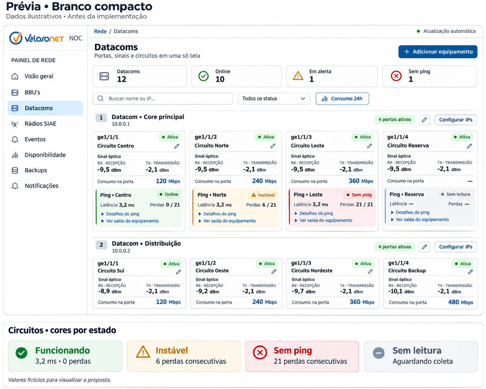

# Prévia — branco compacto

Proposta visual para avaliação antes de implementar mudanças no site.

[Abrir a imagem em tamanho completo](branco-compacto.png)

A proposta mantém a organização dos Datacoms, com cartões compactos de portas,
sinais ópticos, consumo e ping de circuito, em fundo branco e com a logo Velosonet
NOC no menu lateral.

| Cor do circuito | Estado ilustrado |
| --- | --- |
| Verde | Funcionando |
| Amarelo | Instável |
| Vermelho | Sem ping |
| Cinza | Sem leitura |

Os nomes, endereços, contadores e medições são fictícios. A imagem é um mockup
ilustrativo gerado para discutir o visual; seus valores não definem as regras do
monitoramento. O estado da porta física e o resultado do ping do circuito são
informações independentes.

Esta prévia não altera o tema, a logo nem o comportamento do site em execução.
